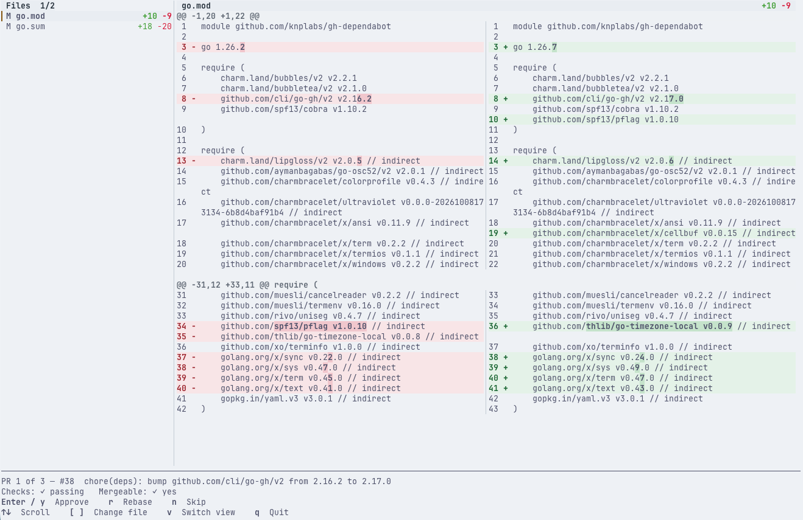

# gh-dependabot

A [GitHub CLI](https://cli.github.com/) extension to interact with pull requests
opened by Dependabot on GitHub.

## Requirements

- [GitHub CLI](https://cli.github.com/) (`gh`) version 2.0 or higher
- [Go](https://golang.org/) version 1.26 or higher (only required for building
  from source)

## Installation

```bash
gh extension install knplabs/gh-dependabot
```

## Usage

Once installed, the extension is available as a `gh` subcommand:

```bash
gh dependabot
```

Use the `--help` flag to see available commands and options:

```bash
gh dependabot --help
```

You can approve Dependabot's PR:

```bash
gh dependabot approve [PR's number...]
```

You can merge Dependabot's PR:

```bash
gh dependabot merge [PR's number...]
```

You can ask Dependabot to rebase its PRs that have conflicts or failing checks:

```bash
gh dependabot rebase [PR's number...]
```

Review Dependabot PRs one by one in the terminal:

```bash
gh dependabot interactive
```

On terminals at least 100 columns wide, the review shows a file list with change
counts and a side-by-side diff. On narrower terminals, it shows a unified diff.
Both views show line numbers and highlight additions and deletions.



| Key             | Action                                                           |
| --------------- | ---------------------------------------------------------------- |
| `↑` / `↓`       | Scroll the diff                                                  |
| `[` / `]`       | Go to the previous or next changed file                          |
| `v`             | Switch between side-by-side and unified views on a wide terminal |
| `y` / `r` / `n` | Approve, request a rebase, or skip the PR                        |
| `Enter` / `q`   | Run the default action shown in the footer, or quit              |

`Enter` approves unless a check is failing, in which case it skips the PR. Use
`--merge` to merge after approval.

Wants more feature? Open an issue, I'll take a look as soon as I can!

## Review with a coding agent

Use GitHub CLI 2.106.0 or later and a gh-dependabot release that includes the
skill and exposes `list` and `view` in `gh dependabot --help`. Install the skill
at user scope to use it across repositories.

```bash
gh skill install KnpLabs/gh-dependabot gh-dependanbot
```

When a new gh-dependabot release is available, update the extension and the
installed skill.

```bash
gh extension upgrade gh-dependabot
gh skill update gh-dependanbot
```

Start an agent session in the repository you want to review and use a request
like this.

```sh
/gh-dependabot
```

The agent lists the PRs, inspects each relevant PR, and reports a recommendation
with evidence.

To authorize a specific action, name the PR and the action you want, for
example, “Do not approve or merge PR #123 even if the update is compatible.”

## Contributing with Ship / Show / Ask

Choose how to land each change on `develop`:

- **Ship** — For a small, familiar change, run `make check` and push signed
  commits directly to `develop`.
- **Show** — Open a PR, check the `show` box, and add the `show` label. Merge
  once CI passes and welcome feedback afterward.
- **Ask** — Open a PR, check the `ask` box, and add the `ask` label. Request a
  review and wait for feedback before merging.

## Building from source

1. Clone the repository:

   ```bash
   git clone https://github.com/knplabs/gh-dependabot.git
   cd gh-dependabot
   ```

2. Build the binary:

   ```bash
   go build -o gh-dependabot
   ```

3. Install it locally as a GitHub CLI extension:

   ```bash
   gh extension install .
   ```

## Testing your changes locally

While iterating on the extension, the fastest loop is to build the binary and
run it directly against a real repository — no `gh extension install` step
between rebuilds. The binary shells out to `gh` (which must be authenticated)
and infers the current repository from your working directory.

1. Build the binary from the project root:

   ```bash
   go build -o gh-dependabot .
   ```

2. Move into a repository that has open Dependabot pull requests:

   ```bash
   cd /path/to/some-repo-with-dependabot-prs
   ```

3. Run the binary directly using its absolute path, for example:

   ```bash
   /path/to/gh-dependabot/gh-dependabot interactive
   ```

   Replace `interactive` with `approve`, `merge`, `rebase`, or omit it to launch
   the default list view. Rebuild and re-run after each change.
